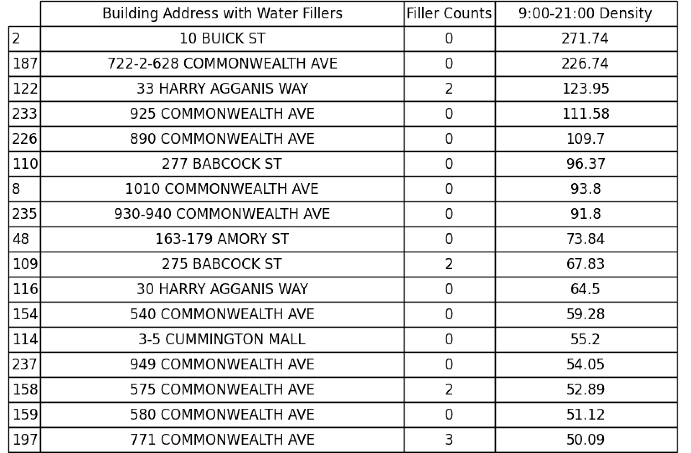
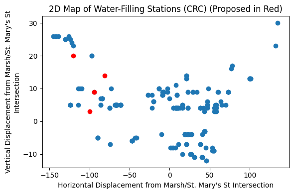

# BU Sustainability: Water-Filling Stations Team A

-   [Overview](#overview)
-   [Data](#data)
-   [Visualizations](#visualizations)
    -   [Base Visualizations](#base-visualizations)
    -   [Extension Visualizations](#extension-visualizations)
-   [Data Cleaning Methods](#data-cleaning-methods)
    -   [Inventory of Existing Filling Stations](#inventory-of-existing-filling-stations)
    -   [WiFi Density Data](#wifi-density-data)
    -   [Kitchens](#kitchens)
    -   [Survey Responses](#survey-responses)
-   [Data Analysis](#data-analysis)
    -   [Inventory of Existing Filling Stations](#inventory-of-existing-filling-stations)
    -   [WiFi Density Data](#wifi-density-data-1)
    -   [Survey Responses](#survey-responses-1)
-   [Base Questions](#base-questions)
    -   [Establish how many students and employees are impacted by each water filling station in the current inventory](#establish-how-many-students-and-employees-are-impacted-by-each-water-filling-station-in-the-current-inventory)
    -   [Establish a full list of the factors and criteria for installing new filling stations](#establish-a-full-list-of-the-factors-and-criteria-for-installing-new-filling-stations)
    -   [A geospatial map of proposed water filling stations highlighted by priority](#a-geospatial-map-of-proposed-water-filling-stations-highlighted-by-priority)
    -   [Establish how many students and employees would have access to each of the proposed new filling stations](#establish-how-many-students-and-employees-would-have-access-to-each-of-the-proposed-new-filling-stations)
-   [Extension Questions](#extension-questions)
    -   [Create a survey to collect information about student body water sustainability habits](#create-a-survey-to-collect-information-about-student-body-water-sustainability-habits)
    -   [Analyze the demographic splits of the collected data (gender, race, age, campus involvement, activity level, etc)](#analyze-the-demographic-splits-of-the-collected-data)
    -   [Use the collected data to create visualizations that can be used by BU sustainability](#use-the-collected-data-to-create-visualizations-that-can-be-used-by-bu-sustainability)
-   [Resources](#resources)
    -   [Documentation](#documentation)
-   [How to Run the Code](#how-to-run-the-code)
    -   [Base Project](#base-project)
    -   [Extension Project](#extension-project)

## Overview

In alignment with Boston University's commitment to sustainability and its Zero
Waste initiative, this project aims to enhance the accessibility and use of
refillable water bottles on campus. The primary objective is to significantly
reduce the use of single-use plastic bottles by increasing the number of water
bottle filling stations. This initiative not only supports environmental
sustainability but also promotes healthier, cost-effective hydration options for
the university community.

Boston University Sustainability has identified a need for data-driven
decision-making to optimize the locations of new filling stations. Our project
will utilize a variety of data sources, including maps of existing stations,
foot traffic patterns, and areas of high student activity density to identify
and recommend potential sites for additional stations.

By analyzing existing data on station usage we created a coordinate system and a
geographic map that displays the density of water-filling stations. We then
integrate it with analytics of campus movement and gathering spots to propose
locations where new stations will serve the potential highest number of users.
The outcome of this project will help BU Sustainability prioritize installation
sites to maximize accessibility and encourage sustainable practices among
students, faculty, and visitors.

## Data

Most of the datasets are located in the folder located at the path of
`./final-report/data`. The only dataset not in that folder is
`updated_densitymap_hourly_cleaned.csv`, which is too big to upload to GitHub.
Before running the code, this file must be downloaded from the shared Google
Drive folder named `Density Map Data` and placed in `./final-report/data`.

-   `50+densities.jpg`: a csv file containing only the addresses at which the
    number visitors between 9:00am and 9:00pm per water-filling station is
    greater than 50. It is created in the file
    `./final-report/code/estimated_foot_traffic_ultimate.ipynb`.
-   `adjusted_density_and_filler_count_display.png`: a csv file containing the
    population density at each address, adjusted for the number of existing
    water-filling stations at each address. It can be thought of as number of
    visitors between 9:00am and 9:00pm per water-filling station located at the
    address. It is created in the file
    `./final-report/code/estimated_foot_traffic_ultimate.ipynb`.
-   `bottle_fillers_inventory.csv`: a modified version of the bottle-filler
    inventory data given by BU Sustainability. It includes additional columns
    labeled `X`, `Y`, and `Z` where X and Y is the horizontal and vertical
    displacement along the coordinate plane (1 unit = 10 meters) and Z is the
    floor on which the station is located (0 is the ground floor). It is used in
    the files `./final-report/code/estimated_foot_traffic_ultimate.ipynb` and
    `./coordinate_display.ipynb`.
-   `building_kitchen_list.csv`: a csv file containing kitchen inventory data
    given by BU Sustainability. It is used in the file
    `./final-report/code/kitchens.ipynb`.
-   `condensed_kitchens.csv`: a csv file containing a condensed version
    inventory of kitchens, keeping only essential columns for maximum
    readability. It is created in the file `./final-report/code/kitchens.ipynb`.
-   `potential_list.csv`: a csv file containing the address, density, and
    coordinates of potential water-filling stations to add. It was manually
    created by looking at the current water-station clusterings and densities.
-   `public_kitchens.csv`: a csv file containing the inventory of public
    kitchens. It is created in the file `./final-report/code/kitchens.ipynb` and
    used in the file
    `./final-report/code/estimated_foot_traffic_ultimate.ipynb`.
-   `residential_kitchens.csv`: a csv file containing the inventory of
    residential kitchens. It is created in the file
    `./final-report/code/kitchens.ipynb`.
-   `survey_responses.csv`: a csv file containing the responses to the water
    sustainability survey. It is used in the file
    `./final-report/extension/survey_visualizations.ipynb`.
-   `updated_densitymap_hourly_cleaned.csv`: the density map data given by BU
    Sustainability. It is used in the file
    `./final-report/code/estimated_foot_traffic_ultimate.ipynb`. This dataset is
    not actually located at this path in the GitHub repository because the file
    is too large for GitHub, so it must be downloaded from the shared Google
    Drive folder named `Density Map Data` and placed in `./final-report/data`
    before the code can be run.

## Visualizations

### Base Visualizations

The visualizations corresponding to the base project are located at the path
`./final-report/visualizations/base/…`. They are all created in
`./final-report/code/coordinate_display.ipynb`.

-   `2D_bottle_filling_stations_clustered.png`: a plot of the existing
    bottle-filling stations on our 2D coordinate system after using the DBSCAN
    algorithm. Points with the same color are within 50 meters of each other.
-   `2D_bottle_filling_stations_unclustered.png`: a plot of the existing
    bottle-filling stations on our 2D coordinate system.
-   `3D_bottle_filling_stations_clustered.png`: a plot of the existing
    bottle-filling stations on our 3D coordinate system after using the DBSCAN
    algorithm. Points with the same color are within 50 meters of each other.
-   `3D_bottle_filling_stations_unclustered.png`: a plot of the existing
    bottle-filling stations on our 3D coordinate system.
-   `bottle_filling_stations_overlay.html`: the HTML file for our interactive
    map of existing bottle-filling stations on the Charles River Campus, created
    using Folium.
-   `bottle_filling_stations_overlay.jpg`: a screenshot of our interactive map
    of existing bottle-filling stations on the Charles River Campus, created
    using Folium.
-   `potential_stations.png`: a plot of the existing bottle-filling stations on
    our 2D coordinate system in blue, with potential new stations plotted in
    red.
-   `proposed_stations.png`: a plot of the existing bottle-filling stations on
    our 2D coordinate system in blue, with proposed new stations plotted in red.

### Extension Visualizations

The visualizations corresponding to the extension project are located at the
path `./final-report/visualizations/extension/…`. They are all created in
`./final-report/extension/survey_visualizations.ipynb` using the survey response
data.

-   `accessibility_refills_bar_charts.png`: charts showing the relationships
    between the perceived accessibility of bottle-filling stations and kitchens
    and their weekly usage.
-   `activity_and_water_bar_charts.png`: charts showing the relationships
    between activity level, weekly bottle-filling-station usage, weekly bottle
    purchase count, and weekly kitchen usage.
-   `activity_level_pie_charts.png`: a chart showing the distribution of hours
    of activity per week among the responses.
-   `gender_pie_charts.png`: a chart showing the gender distribution among the
    responses. Non-binary response options were present, but none of the
    respondents identified as such.
-   `grad_years_pie_charts.png`: a chart showing the grad year distribution
    among the responses.
-   `kitchen_accessibility_pie_charts.png`: a chart showing the distribution of
    perceived kitchen accessibility among the responses.
-   `kitchen_change_pie_charts.png`: a chart showing the distribution of kitchen
    usage change among the responses (“would knowing that tap water in Boston is
    clean increase your kitchen usage?”).
-   `kitchen_refills_pie_charts.png`: a chart showing the distribution of
    kitchen refills per week among the responses.
-   `kitchen_usage_likelihood_charts.png`: a chart showing the relationship
    between kitchen usage and whether respondents would increase their usage
    after being informed that tap water is clean.
-   `purchase_count_pie_charts.png`: a chart showing the distribution of bottle
    purchases per week among the responses.
-   `race_pie_charts.png`: a chart showing the race distribution among the
    responses.
-   `station_accessibility_pie_charts.png`: a chart showing the distribution of
    perceived bottle-filling station accessibility among the responses.
-   `station_refills_pie_charts.png`: a chart showing the distribution of
    bottle-filling station refills per week among the responses.
-   `tap_awareness_pie_charts.png`: a chart showing the tap awareness
    distribution among the responses.

## Data Cleaning Methods

### Inventory of Existing Filling Stations

We've updated this dataset with an important new feature: coordinates. We
created a coordinate system with the origin located at the road in front of the
chapel on Commonwealth Ave. Water-filling stations have been converted into
coordinates, with their locations calculated at a scale of 100 meters to 1 on
the axis. The X-axis runs east-west, the Y-axis runs north-south, and the Z-axis
indicates the floor where each water-filling station is located. Using these
coordinates, we've produced a geographic map that displays the density of
water-filling stations.

### WiFi Density Data

We write a normalization function to apply address normalization to the
`updated_densitymap_hourly_cleaned.csv`, `bottle_fillers_inventory.csv` and
`public_kitchens.csv` files. We have retained Wi-Fi density data only for the
hours between 9:00 AM and 9:00 PM, because this is the time people will use the
water filler station on campus. Then, we match the addresses to determine the
number of students and employees impacted by each water filling station.

### Kitchens

We took the given inventory of kitchen data and condensed it so that only the
relevant columns were taken into account. We also reduced the dataset to include
just public kitchens, which we defined as those located at Warren Towers, Rich
Hall, Claflin Hall, Sleeper Hall, and the Bay State Road Brownstones. We chose
to use this definition, and the list of public kitchens could change if given an
official definition or criteria. Once we got the list of public kitchens, we
converted them into coordinates on our grid and treated them as bottle-filling
stations when calculating the density of people per bottle-filling station at
each address. All of the data manipulation and visualization were done using
pandas and Matplotlib.

### Survey Responses

We created a custom survey for the extension project to assess the current water
sustainability on the Charles River Campus and used the responses to draw
insights into the relationship between different demographics and
characteristics and how sustainable they are when based on using bottle-filling
stations and kitchens. We looked at the response subsets and created different
tables that utilized the responses to different questions to draw conclusions.
All of the data cleaning was done with pandas.

## Data Analysis

### Inventory of Existing Filling Stations/kitchen

With the new datasets and coordinate system, we have produced a 2D and a 3D
geographic map that displays the density of water-filling stations. We then
implement the DBSCAN for clustering to get better visualization. Therefore we
were able to compare the density map with other relevant data to finalize our
targets.

### WiFi Density Data

We first performed normalization on the `updated_densitymap_hourly_cleaned.csv`,
`bottle_fillers_inventory.csv`, and `public_kitchens.csv` files. We also
manually added some address matching to ensure that the addresses in the
`bottle_fillers_inventory.csv` and `public_kitchens` could be fully matched
within the density map. We retained the density map data only for the hours
between 9:00 AM and 9:00 PM, as this is when people are most likely to use the
water filler stations on campus. Subsequently, we calculated the sum of foot
traffic for each location. If a location has multiple water stations, we divided
the sum of foot traffic by the number of water stations. Finally, we generated a
table to determine the number of students and employees impacted by each water
filling station. For locations without water stations, we also calculated the
foot traffic. This data helps us identify areas with high foot traffic yet
lacking water stations, suggesting potential sites for new installations.

### Survey Responses

After cleaning the data, we categorized the questions from the survey into
attributes. We first presented the responses to all attributes in pie charts,
which illustrated the characteristics and opinions of the respondents. Following
this, we created several bar charts to depict the relationships between
attributes. We believe that the use of water stations, purchasing water, and
using kitchens to refill water are related to individuals’ Physical Activity
Level and the Accessibility of hydration locations. We also think that informing
people about the cleanliness and health benefits of kitchen refills may
encourage more individuals to use this option. The results of our charts
validate some of our hypotheses and provide our clients with a more intuitive
presentation of data visualization.

## Base Questions

### Establish how many students and employees are impacted by each water filling station in the current inventory

Below is a screenshot of all of the addresses with a daily average of 50+
students per water-filling station between the hours of 9:00am and 9:00pm. The
data was created for all of the addresses in the the inventory, but only the
densities of 50+ are pictured to save space.

### Establish a full list of the factors and criteria for installing new filling stations

1. `Distance between existing bottle-filling stations`. This is the most
   important factor because water-filling stations should only be installed at
   locations that are far from already existing stations. This will be used to
   do cluster/density analysis and determine which regions of the Charles River
   Campus are relatively scarce to create an exhaustive list of potential
   stations to install.
2. `Student foot-traffic`. This is the second most important factor because it
   will ensure the new stations are useful. This will be used to rank the
   exhaustive list created using the distances in the order of potential usage,
   and also eliminate some locations that do not need a water-filling station
   because of low foot traffic.
3. `Building ventilation`. This is the third most important factor because a
   building without mechanical ventilation will be significantly more hot and
   humid in the period from late Spring to Early Fall. This will result in more
   people drinking water more frequently, greatly increasing the demand for
   water-filling stations.
4. `Existing plumbing infrastructure`. This is the fourth most important factor
   because building a water-filling station near existing plumbing is
   significantly easier and cost-effective.
5. `Proximity to an existing public kitchen`. This is the fifth most important
   factor because people can refill their bottles from public kitchens. In
   reality, it is less likely that people will go out of their way to go to a
   kitchen to fill their water bottles. Some people will feel that the water
   from the kitchen is not as clean as that from the water-filling station, even
   though both would be filtered, and choose not to fill their water bottles.
   For both of these reasons, this factor is at the bottom of the ranking.
6. `Student feedback/suggestions`. This is the least important factor because it
   can be susceptible to incorrect assumptions, bias, and an overall lack of
   reasoning. Regardless, it could still provide useful information because, at
   the end of the day, the students are the people who use the bottle-filling
   stations the most. The students may feel that there is a need for more
   water-filling stations at a location that is not necessarily indicated by the
   data.

### A geospatial map of proposed water filling stations highlighted by priority

Below is a 2D map of the Charles River Campus with existing bottle-filling
stations marked in blue. For reference, the origin (0,0) is the intersection in
of St. Mary’s Street and Commonwealth Avenue in front of Marsh Chapel. The red
dots are the proposed water-filling stations. They are 925 Commonwealth Avenue
(Agganis Arena), 277 Babcock Street (Rich Hall), 949 Commonwealth Avenue (Boston
Playwright’s Theater), and 10 Buick Street (Stuvi I).

### Establish how many students and employees would have access to each of the proposed new filling stations

-   `925 Commonwealth Avenue (Agganis Arena)`: an average of 111.58 per day is
    based on the WiFi density data, but this would have extreme variations and
    spikes and non-BU visitors.
-   `277 Babcock Street (Rich Hall)`: an average of 96.37 per day is based on
    the WiFi density data and is useful to students passing through and those
    using Nickerson field.
-   `949 Commonwealth Avenue (Boston Playwright’s Theater)`: an average of 54.05
    per day is based on the WiFi density data and is useful non-BU students as
    well.
-   `10 Buick Street (Stuvi I)`: an average of 271.74 per day is based on the
    WiFi density data. Apartments limit effectiveness, but it could be
    convenient for the students who congregate in the lobbies.

## Extension Questions

### Create a survey to collect information about student body water sustainability habits

#### Survey Questions:

`What is your year of graduation?`

-   2024
-   2025
-   2026
-   2027
-   2028+

`In what college(s) do you study at Boston University?`

-   College of Arts & Sciences
-   College of Communication
-   College of Engineering
-   College of Fine Arts
-   College of General Studies
-   Faculty of Computing and Data Sciences
-   Pardee School of Global Studies
-   Sargent College of Health
-   School of Hospitality Administration
-   Questrom School of Business
-   Other (including graduate programs)

`How would you describe your gender?`

-   Woman
-   Man
-   Transgender
-   Gender Neutral
-   Other
-   I prefer not to respond

`How would you describe your race?`

-   Asian
-   Black or African American
-   Hispanic/Latino
-   Indigenous
-   Middle Eastern/North African
-   Native Hawaiian or Pacific Islander
-   White
-   Another race or ethnicity
-   I prefer not to respond

`How many hours of physical activity do you do per week?`

-   0
-   1-2
-   3-5
-   6+

`How many times per week do you use a water-filling station to refill your water bottle?`

-   0
-   1-2
-   3-5
-   6+

`How easily accessible are the water-filling stations on campus?`

-   It is hard to find one.
-   It takes too long to find one.
-   It takes some time to find one, but it is manageable.
-   It is easy to find one.

`How many times per week do you purchase bottled water on campus?`

-   0
-   1-2
-   3-5
-   6+

`How many times per week do you use a publicly accessible kitchen sink on campus to refill your water bottle?`

-   0
-   1-2
-   3-5
-   6+

`How easily accessible are the public kitchen sinks on campus?`

-   It is hard to find one.
-   It takes too long to find one.
-   It takes some time to find one, but it is manageable.
-   It is easy to find one.

`Did you know that the tap water in Boston is among the cleanest and safest in the country?`

-   Yes
-   No

`Does the information in question 11 change your answer to question 8?`

-   I already use the kitchen sinks
-   Yes
-   No

### Analyze the demographic splits of the collected data

#### The Big Takeaways:

-   People who are already active are already sustainable. It makes more sense
    to increase sustainability among those who are relatively inactive.
-   There is a big correlation between accessibility and sustainability. The
    people who use the most filling stations find them easily, and the people
    who use the least kitchens cannot find them.
-   Tap water awareness can lead more people to use kitchens. Among those who do
    not use kitchens at the moment, half are willing to use them after learning
    that tap water is clean.

### Use the collected data to create visualizations that can be used by BU sustainability

The visualizations linking survey responses are located at the path
`./final-report/visualizations/extension`.

## Resources

### Documentation

-   pandas: https://pandas.pydata.org/docs/
-   Matplotlib: https://matplotlib.org/stable/index.html
-   DBSCAN:
    https://scikit-learn.org/stable/modules/generated/sklearn.cluster.DBSCAN.html
-   Folium: https://python-visualization.github.io/folium/latest/reference.html

## How to Run the Code

### Base Project

The three main code files are `coordinate_display.ipynb`,
`estimated_foot_traffic_ultimate.ipynb`, and `kitchens.ipynb`, located in the
folder at path `./final-report/code`. Each of these files are Jupyter notebooks
and should be run starting with the top cell and continuing to the bottom. All
of the file paths are updated to be correct. Before running
`estimated_foot_traffic_ultimate.ipynb`, the file
`updated_densitymap_hourly_cleaned.csv` must be downloaded from the shared
Google Drive folder named `Density Map Data` and placed in
`./final-report/data`.

### Extension Project

There is an additional code file named `survey_visualizations.ipynb` located in
the folder at path `./final-report/extension`. This is also a Jupyter notebook
and should also be run starting with the top cell and continuing to the bottom.
